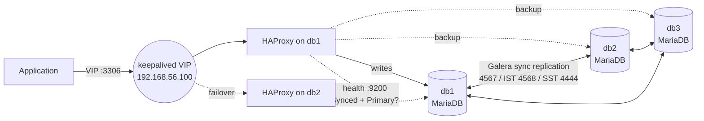

# Dhruva HA: self-healing MySQL cluster (MariaDB Galera + HAProxy + SaltStack)

[](https://github.com/KSHITISH05/dhruva-ha/actions/workflows/ci.yml)

*Dhruva is the pole star that never moves. The database endpoint stays put while the nodes under it fail and recover.*

A three-node MariaDB Galera cluster behind HAProxy, with a keepalived floating IP and
host firewalls, configured entirely by **SaltStack**. Every push brings the cluster up
in CI, **kills the database that is taking writes**, and checks that the cluster keeps
accepting writes without losing a single acknowledged transaction.

## Architecture



- **Galera** replicates every commit synchronously to all nodes: a commit is acknowledged only once the other nodes have it.
- **HAProxy** sends all writes to one node (single-writer) and keeps the others as hot standbys.
- **`galera_health.py`** on each node tells HAProxy whether the node is really usable (Synced + Primary component), not just whether port 3306 answers.
- **keepalived** moves the VIP to db2 if HAProxy or db1 dies.
- **iptables** (via Salt): Galera, IST, SST and health ports are open only to cluster members; MySQL only to the app network.

## What CI proves on every push

1. **Lint and render**: ruff, shellcheck, and the full Salt highstate rendered for db1, db2 and db3, plus `haproxy -c` on the generated config.
2. **Real cluster**: Salt installs MariaDB, Galera, HAProxy and the firewall, then the cluster bootstraps on db1 and db2/db3 join with a full state transfer (SST).
3. **Idempotency**: a second Salt run must report zero changes.
4. **Failover drill** (`scripts/failover_drill.py`): writes every 50 ms through HAProxy, `SIGKILL`s the writer, measures the write interruption, checks every acknowledged write exists on both survivors, restarts the killed node and checks it catches up (IST) with identical data. Results land in the job summary.

## Measured results

Single-host lab (all three nodes on one machine), 30 s of writes at ~20/s, writer killed with `SIGKILL`:

| | Galera defaults (1 run) | Tuned failure detection (2 runs) |
|---|---|---|
| Write interruption | 6.2 s | **3.2 s** |
| Acknowledged writes lost | 0 | **0** |
| Killed node back in sync (IST) | 4.3 s | 4.3–6.4 s |

The first run showed writes stalling for ~6 s although HAProxy switched over in ~2 s.
The stall came from Galera keeping the dead node in the cluster view until
`evs.suspect_timeout` (5 s) expired. Lowering it to 2 s halved the interruption.
The trade-off is documented in [docs/RUNBOOK.md](docs/RUNBOOK.md#6-failure-detection-tuning-measured).

## Design decisions

| Decision | Why |
|---|---|
| Single writer, others `backup` in HAProxy | Writing to several Galera nodes at once causes certification conflicts (deadlock errors) on hot rows. |
| Galera-aware HTTP health check | A TCP or `mysql-check` would send traffic to a node that is a blocked SST donor or in a non-Primary partition. |
| `on-marked-down shutdown-sessions` / `on-marked-up shutdown-backup-sessions` | Clients reconnect to the new writer at once, and there is never more than one writer after the old one returns. |
| Salt does **not** restart MariaDB on config change | Restarting every node together would take the cluster down; changes roll out with `scripts/rolling_restart.sh`. |
| Firewall in its own `LAB-INPUT` chain, rules inserted at fixed positions | Never flushes rules owned by others; a rule added later can't end up behind the final DROP. |
| `innodb_flush_log_at_trx_commit = 2` | Durability comes from synchronous replication; trade-off noted in the runbook. |

## Run it

**Single host** (any Ubuntu 24.04 VM, the same path CI uses):

```bash
sudo pip install --break-system-packages "salt==3007.*" pymysql
sudo scripts/single_host_lab.sh up
sudo python3 scripts/failover_drill.py --kill-cmd 'scripts/single_host_lab.sh kill {node}' \
  --restart-cmd 'scripts/single_host_lab.sh start {node}' \
  --node db1=127.0.0.1:3311 --node db2=127.0.0.1:3312 --node db3=127.0.0.1:3313
sudo scripts/single_host_lab.sh down
```

**Three VMs** (VirtualBox, or KVM/QEMU via `vagrant up --provider=libvirt`):

```bash
vagrant up           # db1 bootstraps, db2 and db3 join; Salt applies the highstate on each
python3 scripts/failover_drill.py --host 192.168.56.100 --user app --password change-me-in-a-secret-pillar \
  --database appdb --kill-cmd 'vagrant ssh {node} -c "sudo systemctl kill -s SIGKILL mariadb"' \
  --restart-cmd 'vagrant ssh {node} -c "sudo systemctl start mariadb"' \
  --node db1=192.168.56.11:3306 --node db2=192.168.56.12:3306 --node db3=192.168.56.13:3306
```

## Verification status

| Path | Status |
|---|---|
| Single-host cluster, idempotency, failover drill | Verified in CI on every push |
| VM-lab Salt states (db1–db3) | Rendered + dry-run (`test=True`) in CI/locally |
| Vagrant 3-VM lab with keepalived VIP | Written, not yet run end-to-end |

## Layout

```
salt/                 Salt states (common, firewall, galera, haproxy, keepalived, healthcheck)
pillar/               lab_vms.sls (3 VMs) and single_host.sls (CI) - same states, different data
scripts/              single_host_lab.sh, failover_drill.py, rolling_restart.sh, vagrant_provision.sh
docs/RUNBOOK.md       node down, full-cluster restart, split brain, rolling restart, tuning
Vagrantfile           3 Ubuntu VMs on a host-only network
```

## References

- Galera Cluster docs: [crash recovery](https://galeracluster.com/library/documentation/crash-recovery.html), [EVS parameters](https://galeracluster.com/library/documentation/galera-parameters.html)
- Prior art studied: [alextricity25/mariadb-galera-salt-ubuntu-formula](https://github.com/alextricity25/mariadb-galera-salt-ubuntu-formula), [lkubb/salt-mariadb-formula](https://github.com/lkubb/salt-mariadb-formula), [vlcty/mariadb-galera-sandbox](https://github.com/vlcty/mariadb-galera-sandbox)

MIT licensed.
